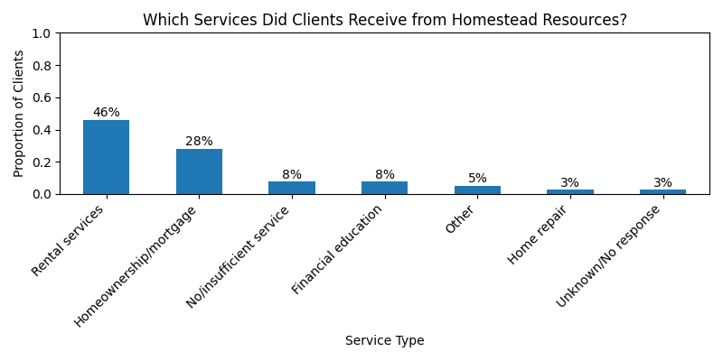
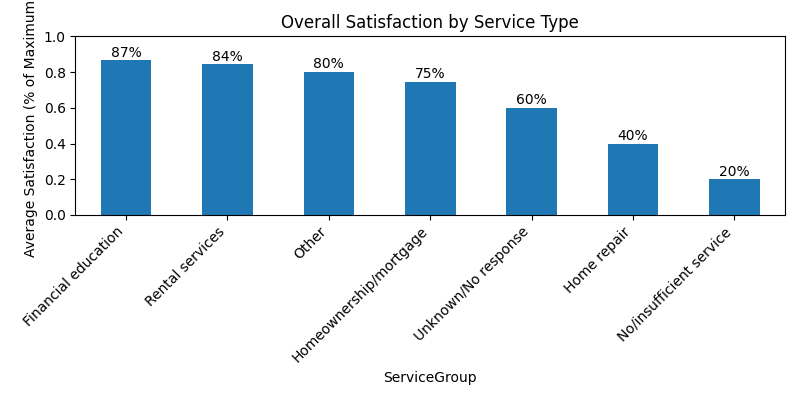
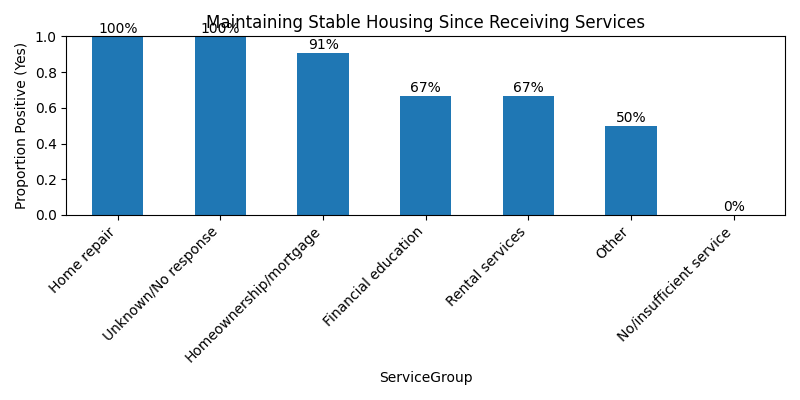
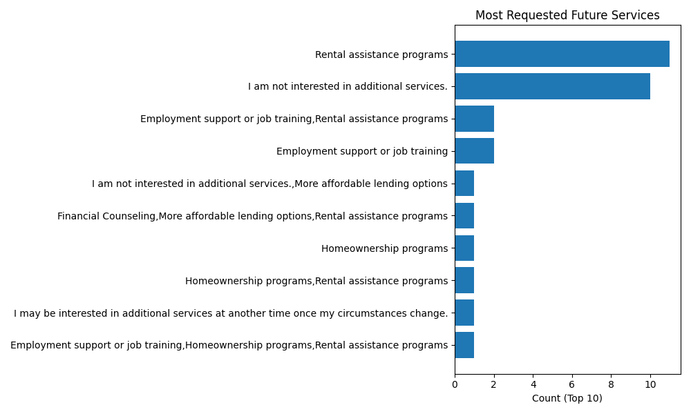

# Homestead Resources – Home & Rental Services Analysis

Data analysis for **Homestead Resources**, a nonprofit focused on housing stability and financial counseling, completed through **The Data Exchange at Purdue University** (Spring 2026).

I led the **Home & Rental Services** part of a team project. The goal was to find out which housing services clients use most, and how those services relate to housing outcomes, satisfaction, and recommendations.

> **Data note:** The client survey data is confidential and is **not included** in this repository. The code and output charts are shared with personal information removed.

## Approach
- Loaded and cleaned client survey responses with pandas.
- Grouped free-text service answers (Q4) into service categories using keyword rules
- Measured positive-outcome rates by service type for:
  - rental counseling helping secure or maintain housing (Q5)
  - successful home purchases (Q6)
  - maintaining stable housing (Q7)
- Compared average satisfaction (Q13, 1–5 scale) across services and by housing-stability outcome
- Summarized recommendation rates (Q12) and the additional services clients requested (Q14)

## Key Findings
- **Rental services** were the most-used category (18 of 39 respondents), followed by homeownership/mortgage services (11)
- **46%** of respondents rated their overall satisfaction 5 out of 5 (mean 3.74)
- **Rental assistance** was also the most-requested future service, followed by employment support and job training
- The team recommended investing more in rental and mortgage assistance and adding employment training programs

## Visualizations
| | |
|---|---|
|  |  |
|  |  |

All 8 charts are in [`plots/`](plots/).

## Tools
Python · pandas · Matplotlib

## Running
`analysis.py` expects the survey export (`Client Survey All Data Export.xlsx`) in the same folder. It saves all charts to `plots/`.
